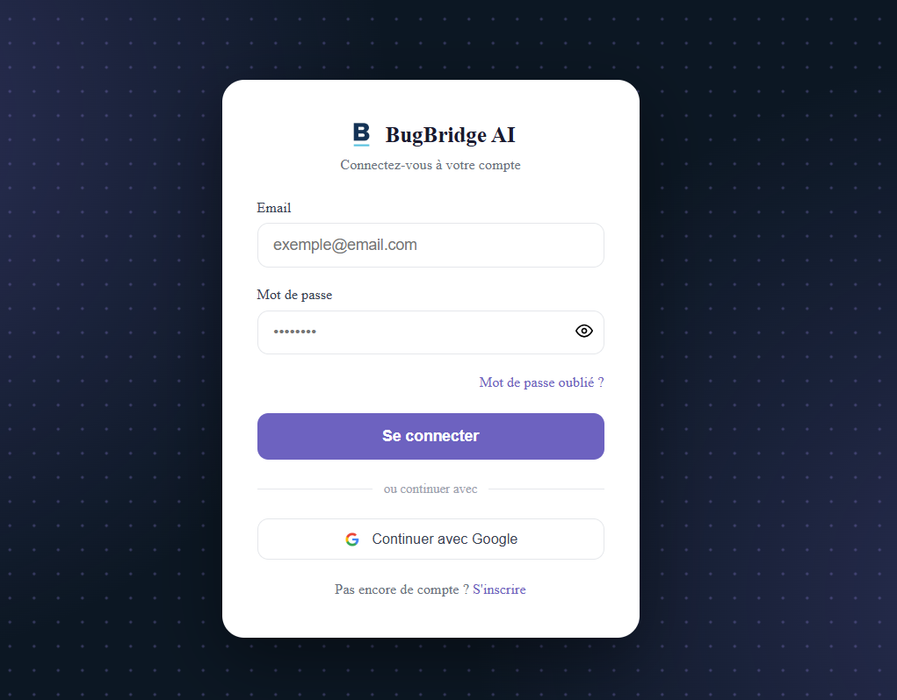
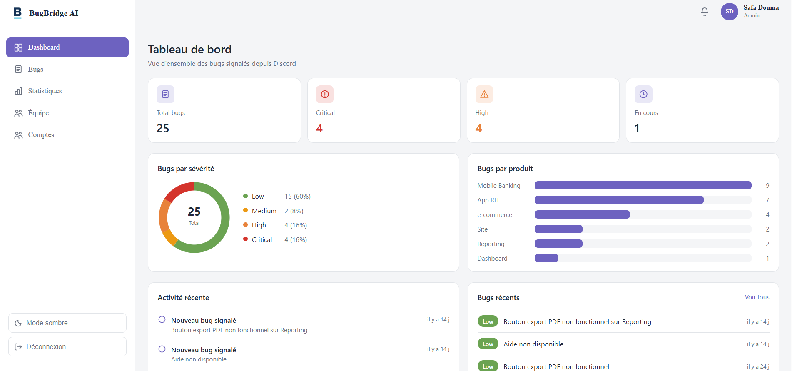
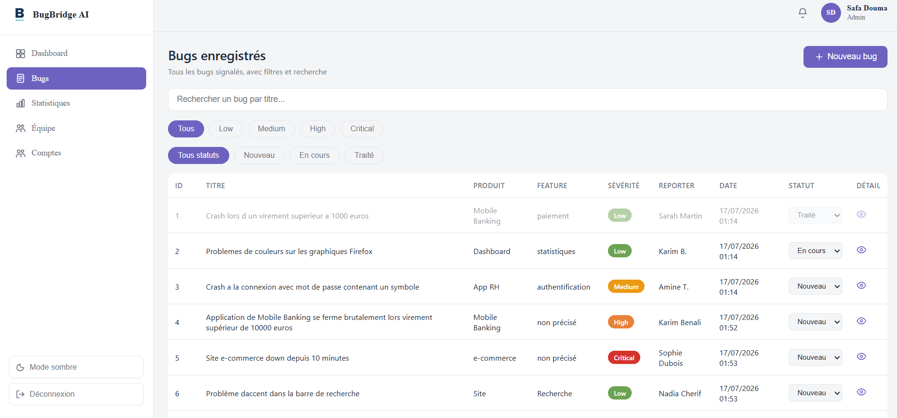
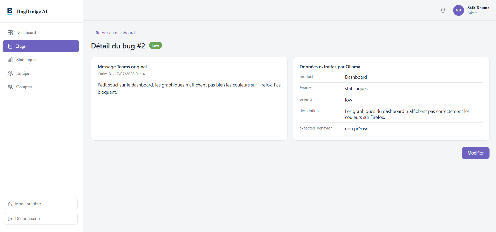
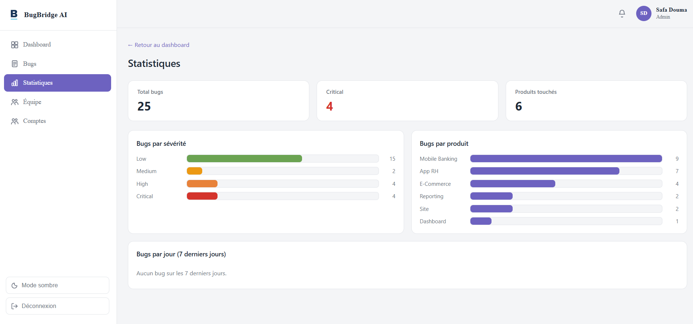
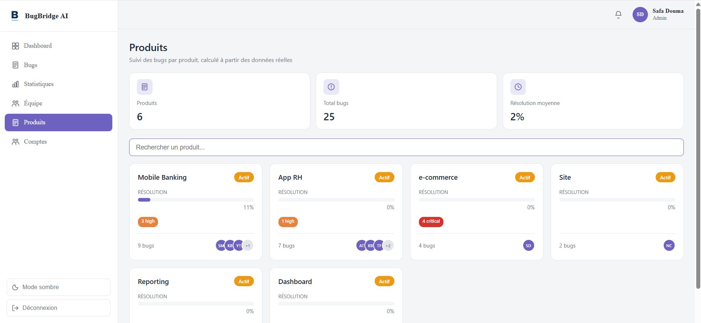

#  BugBridge AI

**Transformer automatiquement un message de bug en ticket structuré grâce à l'intelligence artificielle.**

>  Ce dépôt présente le projet : l'idée, le fonctionnement et des captures d'écran de l'application. Le code source n'est pas publié.

---

##  Le problème

Pendant les phases de test, les testeurs signalent les bugs dans un canal de discussion de l'équipe. Le ticket correspondant est ensuite créé **à la main** par un testeur ou un développeur.

Conséquences :
-  perte de temps ;
-  bugs oubliés ;
-  doublons ;
-  dépendance à la disponibilité d'une personne.

##  L'idée

> Le testeur écrit son message normalement… et le ticket se crée tout seul.

BugBridge AI récupère le message, le fait analyser par un modèle de langage **exécuté en local**, vérifie les informations extraites, écarte les doublons et enregistre le bug. L'équipe suit ensuite tout depuis une application web.

##  Comment ça marche

1. **Le testeur** publie son message dans le canal de discussion.
   *Exemple : « Le site e-commerce est down depuis 10 minutes, plus aucune commande ne passe. »*
2. **Un webhook** transmet le message au backend **FastAPI**.
3. **Llama 3.2**, exécuté en local avec **Ollama**, extrait : titre, produit, fonctionnalité, sévérité, description et comportement attendu.
4. **Pydantic** vérifie que les données sont complètes et au bon format.
5. **La détection des doublons** compare le bug avec ceux déjà enregistrés.
6. **SQL Server** enregistre le nouveau bug.
7. **L'application Angular** l'affiche dans le tableau de bord.

 **Tout tourne en local** : aucune donnée n'est envoyée à un service externe, et il n'y a aucun abonnement à une API d'IA payante.

##  Captures d'écran

### Connexion sécurisée

### Tableau de bord
Nombre total de bugs, bugs critiques, répartition par sévérité et par produit.

### Gestion des bugs
Liste des bugs avec recherche, filtres par sévérité et changement de statut (Nouveau → En cours → Traité).

### Détail d'un bug
À gauche, le message original du testeur ; à droite, les informations extraites automatiquement par l'IA.

### Statistiques

### Suivi par produit
Nombre de bugs et taux de résolution pour chaque produit.

##  Fonctionnalités

- Réception automatique des messages de bugs (webhook)
- Extraction des informations par un modèle de langage local
- Validation des données et journalisation des erreurs
- Détection des doublons
- Tableau de bord, statistiques, suivi par produit et par testeur
- Recherche, filtrage, modification et gestion des statuts des bugs
- Authentification JWT, rôles **Membre** et **Administrateur**, validation des nouveaux comptes par l'administrateur
- Réinitialisation du mot de passe par e-mail
- Mode clair / mode sombre

##  Technologies

| Rôle | Technologie |
|---|---|
| Backend et API REST | Python, FastAPI |
| Intelligence artificielle | Ollama, Llama 3.2 |
| Validation des données | Pydantic |
| Base de données | SQL Server |
| Interface web | Angular |
| Canal de test | Discord, discord.py |

##  Perspectives

- Intégration avec Microsoft Teams
- Suite de tests automatisés (pytest)
- Comparaison de plusieurs modèles de langage
- Notifications automatiques pour les bugs critiques
- Export des données vers Excel
